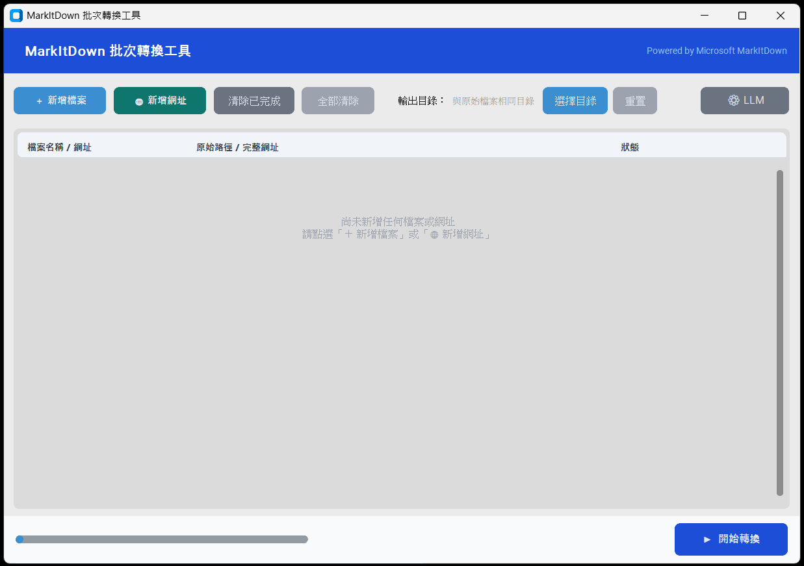

# MarkItDown Batch Converter

<p align="center">
  
  
  
  
  
</p>

**[繁體中文](README.zh-TW.md) | English**

A GUI batch converter that converts various file formats to Markdown using [Microsoft MarkItDown](https://github.com/microsoft/markitdown).



## Features

- Batch convert multiple files at once
- Supported formats: PDF, Word, PowerPoint, Excel, HTML, Images, ZIP, EPUB, and more
- **URL conversion**: Enter any URL to fetch and convert web pages to Markdown
- Custom output directory (defaults to same folder as source file)
- Conflict handling: Overwrite / Auto-rename / Skip
- Per-file status display and progress tracking
- **LLM integration**: Ollama, OpenAI, OpenRouter, Gemini — for image description and OCR
- Automatic fallback to plain conversion when LLM call fails
- LLM settings are persisted automatically

## Usage

### End Users (no Python required)

Download the `dist/MarkItDownApp/` folder and run `MarkItDownApp.exe` directly.

### Developers

**First-time setup:**

```
setup.bat
```

**Run in development mode:**

```
run.bat
```

**Build standalone executable:**

```
build.bat
```

After building, distribute the entire `dist/MarkItDownApp/` folder.

## Requirements

- OS: Windows 10 / 11 (64-bit)
- Python: 3.10+ (only required for development mode)

## Project Structure

```
MarkItDown App/
├── app.py              # Main application
├── app.spec            # PyInstaller build config
├── requirements.txt    # Python dependencies
├── setup.bat           # First-time environment setup
├── run.bat             # Development mode launcher
├── build.bat           # Build to exe
└── dist/               # Build output (generated by build.bat)
    └── MarkItDownApp/
        └── MarkItDownApp.exe
```

- OS: Windows 10 / 11 (64-bit)
- Python: 3.10+ (only required for development mode)

### Project Structure

```
MarkItDown App/
├── app.py              # Main application
├── app.spec            # PyInstaller build config
├── requirements.txt    # Python dependencies
├── setup.bat           # First-time environment setup
├── run.bat             # Development mode launcher
├── build.bat           # Build to exe
└── dist/               # Build output (generated by build.bat)
    └── MarkItDownApp/
        └── MarkItDownApp.exe
```
