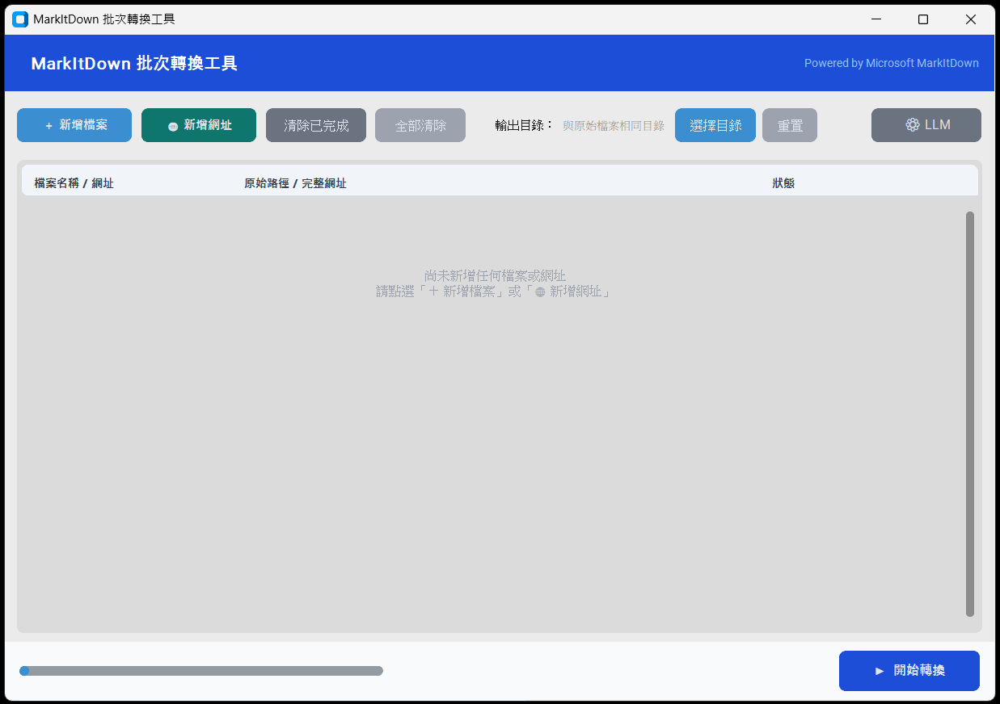

# MarkItDown 批次轉換工具

<p align="center">
  
  
  
  
  
</p>

**繁體中文 | [English](README.md)**

透過 [Microsoft MarkItDown](https://github.com/microsoft/markitdown) 將各種檔案批次轉換為 Markdown 格式的圖形化工具。



## 功能

- 一次選取多個檔案進行轉換
- 支援格式：PDF、Word、PowerPoint、Excel、HTML、圖片、ZIP、EPUB 等
- **URL 直接轉換**：輸入網址即可抓取頁面並轉為 Markdown
- 自訂輸出目錄（預設與原始檔案相同位置）
- 同名衝突處理：覆蓋 / 自動重命名 / 略過
- 每個檔案獨立狀態顯示與進度追蹤
- **LLM 整合**：支援 Ollama、OpenAI、OpenRouter、Gemini，用於圖片描述與 OCR
- LLM 呼叫失敗時自動降級為純文字轉換，不中斷流程
- LLM 設定自動持久化

## 使用方式

### 一般使用者（免安裝 Python）

下載 `dist/MarkItDownApp/` 資料夾，直接執行 `MarkItDownApp.exe`。

### 開發者

**首次設定：**

```
setup.bat
```

**執行（開發模式）：**

```
run.bat
```

**打包為獨立執行檔：**

```
build.bat
```

打包完成後，整個 `dist/MarkItDownApp/` 資料夾即為可分發的應用程式。

## 系統需求

- 作業系統：Windows 10 / 11（64 位元）
- Python：3.10 以上（僅開發模式需要）

## 專案結構

```
MarkItDown App/
├── app.py              # 主程式
├── app.spec            # PyInstaller 打包設定
├── requirements.txt    # Python 依賴清單
├── setup.bat           # 首次環境設定
├── run.bat             # 開發模式啟動
├── build.bat           # 打包為 exe
└── dist/               # 打包輸出（build.bat 後產生）
    └── MarkItDownApp/
        └── MarkItDownApp.exe
```
